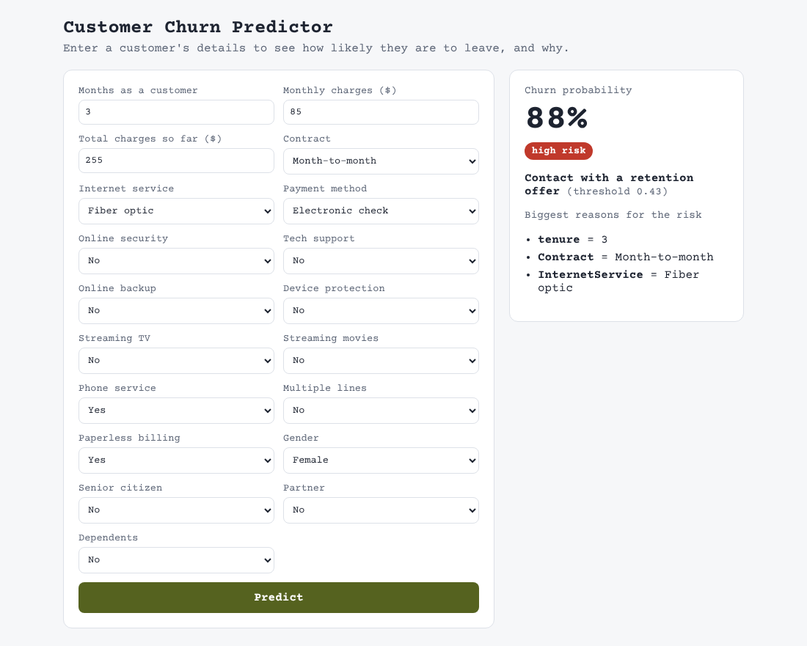
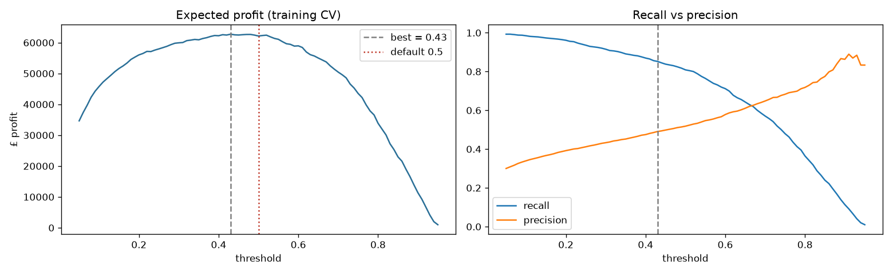
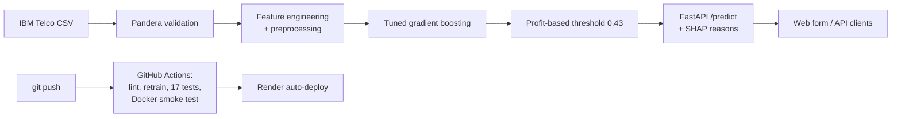
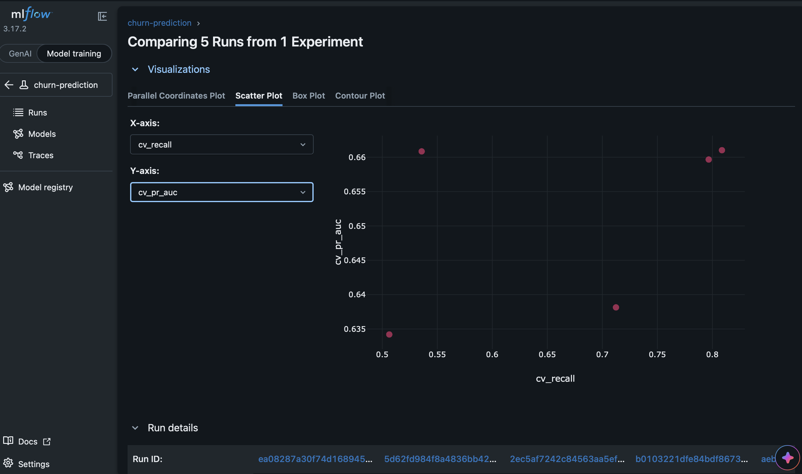
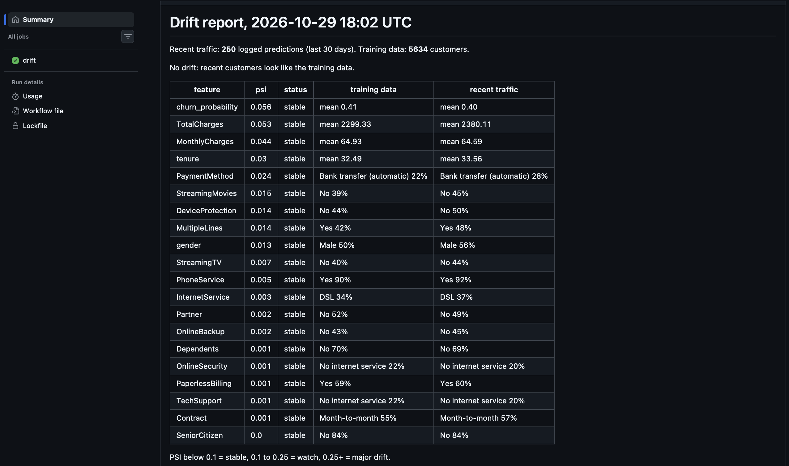
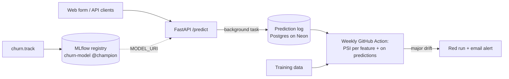

# Customer Churn Prediction

[](https://github.com/mhamad1213/churn-prediction/actions/workflows/ci.yml)
[](https://github.com/mhamad1213/churn-prediction/actions/workflows/drift.yml)


Predicting which telecom customers are about to leave, explaining **why**, and deciding **who is worth contacting**, served as a live web app and API.

### 🔗 Live demo: https://churn-prediction-hbcb.onrender.com
*Hosted on Render's free tier: the first visit after a quiet spell takes up to a minute to wake up. API docs at [`/docs`](https://churn-prediction-hbcb.onrender.com/docs).*



## Highlights
- **Recall on churners up from 56% to 80%** on held-out data by handling class imbalance and tuning gradient boosting (PR-AUC 0.634 → 0.667).
- **Decision threshold set by profit, not the 0.5 default:** £15,060 simulated campaign profit, **+21%** vs the baseline model and **2.7×** contacting everyone.
- **Every prediction is explained** with its top 3 risk drivers (SHAP).
- **Production pipeline:** Pandera + Pydantic validation, 32 pytest tests, GitHub Actions retrains the model from scratch on every push, Docker image smoke-tested in CI, auto-deployed to Render.
- **Monitored after deployment:** every live prediction is logged to Postgres (Neon), a weekly job checks for data drift with PSI, and models are versioned in an MLflow registry with a `@champion` promotion rule. A simulated price rise was flagged as major drift (PSI 1.43 on monthly charges).

## Problem
A subscription business loses revenue every time a customer cancels. If we can rank customers by churn risk, a retention team can contact the riskiest ones first. Success is measured by **churners caught and profit**, not raw accuracy: on this data, predicting "nobody churns" is already 73.5% accurate.

## Data
[IBM Telco Customer Churn](https://github.com/IBM/telco-customer-churn-on-icp4d): 7,043 customers, 19 features (contract, services, billing, tenure), 26.5% churn. Cleaned and validated with a Pandera schema (`src/churn/data.py`). Exploration in `notebooks/01_eda.ipynb`.

## Results (held-out test set, 1,409 customers)

| Model | ROC-AUC | PR-AUC | Recall (churners) | Precision |
|---|---|---|---|---|
| Logistic regression baseline | 0.842 | 0.634 | 0.559 | 0.657 |
| **Tuned gradient boosting, class-balanced** | **0.846** | **0.667** | **0.799** | 0.507 |

**Model comparison (5-fold cross-validation on the training set):**

| Model | ROC-AUC | PR-AUC |
|---|---|---|
| Logistic regression (balanced) | 0.846 | 0.660 |
| Random Forest | 0.844 | 0.655 |
| **Gradient boosting (tuned, balanced)** | **0.849** | **0.661** |
| PyTorch neural network (MLP) | 0.843 | 0.647 |

All models land close together, which is typical for tabular data of this size. The biggest gain came from **handling class imbalance**, not from model choice. Gradient boosting was kept as it scored best on PR-AUC and is fast and explainable.

### Choosing who to contact
Assumptions: a retention offer costs **£20**, a saved customer is worth **£300**, and offers work **30%** of the time. Expected profit was computed at every threshold on cross-validated predictions; **0.43** maximised it.



| Strategy (test set) | Simulated profit |
|---|---|
| Contact everyone | £5,480 |
| Baseline model, 0.5 threshold | £12,450 |
| **Tuned model, 0.43 threshold** | **£15,060** |

## How it works



- **One scikit-learn pipeline** (feature engineering → scaling/one-hot → model) is used for training *and* serving, so there is no train/serve mismatch and no data leakage in cross-validation.
- **`POST /predict`** takes a customer's details and returns the churn probability, risk level, whether to contact them, and the top 3 reasons. Input is validated twice: Pydantic (types and ranges) then Pandera (same schema as training).
- **Docker:** the image downloads the data and trains the model during the build, so the model is always saved and loaded with the same library versions. Slim runtime dependencies (no torch/jupyter), non-root user, about 140 MB of RAM in use.

## Monitoring and model versioning
A model that scored well last month can quietly get worse when customers change. Three pieces watch for that.

**1. Model registry (MLflow).** `python -m churn.track` records each training run: the tuned settings, cross-validated and test scores, the £ profit at the chosen threshold, and the plots, with one child run per candidate model so they can be compared side by side. The model is registered as `churn-model` (versions 1, 2, 3...). A new version only takes the **`@champion`** alias if its test PR-AUC is at least as good as the current champion's, so a worse retrain can't silently replace a better model. The API can serve straight from the registry with `MODEL_URI=models:/churn-model@champion`, and `GET /model-info` reports which model is running.



**2. Prediction log.** Every `/predict` call is saved (all 19 inputs, probability, decision, model, timestamp) in a background task, so logging adds no latency and a database outage never breaks a prediction. Locally it goes to SQLite; in production `PREDICTION_DB_URL` points it at Postgres on Neon. `GET /monitoring/summary` shows volume, average risk and contact rate.

**3. Weekly drift check.** Every Monday a GitHub Action compares the last 30 days of logged customers with the training data using the **Population Stability Index**, for each feature and for the model's output (`churn_probability`). PSI below 0.10 is stable, 0.10 to 0.25 is worth watching, and 0.25 or more is major drift, which fails the run so GitHub sends an alert. The report appears on the run page.



To check that the alarm really fires, `scripts/simulate_traffic.py --shift` sends customers after a pretend 30% price rise plus a wave of new monthly-contract sign-ups:

| Feature | Normal traffic (PSI) | Shifted traffic (PSI) |
|---|---|---|
| MonthlyCharges | 0.048 stable | **1.431 major drift** |
| tenure | 0.035 stable | **0.450 major drift** |
| TotalCharges | 0.046 stable | **0.337 major drift** |
| churn_probability | 0.055 stable | 0.201 watch |
| gender (unchanged) | 0.002 stable | 0.002 stable |

The contact rate also jumped from 41% to 60%, exactly the kind of change a retention team would want explained before spending the budget. The check refuses to judge fewer than 200 predictions: with 100 normal customers, random noise alone gave a PSI of 0.245.



## Project structure
```
├── .github/workflows/ci.yml   # lint, retrain from scratch, test, build + smoke-test Docker image
├── .github/workflows/drift.yml # weekly PSI drift check on the live prediction log
├── Dockerfile                 # production image: trains the model at build time, serves the API
├── requirements.txt           # full dev environment
├── requirements-deploy.txt    # slim runtime dependencies (no torch/jupyter)
├── data/raw/                  # downloaded CSV (git-ignored)
├── docs/                      # screenshots
├── models/                    # threshold.json (model file is rebuilt by training)
├── notebooks/                 # EDA and feature exploration
├── reports/                   # metrics JSON + figures
├── scripts/download_data.py
├── scripts/simulate_traffic.py # send real (or deliberately drifted) customers to the API
├── src/churn/
│   ├── data.py                # load, clean, Pandera schemas
│   ├── features.py            # feature engineering + preprocessing
│   ├── evaluate.py            # metrics incl. top-20% lift
│   ├── train_baseline.py      # logistic regression baseline
│   ├── train_models.py        # RF / gradient boosting comparison
│   ├── tune.py                # class imbalance + hyperparameter tuning
│   ├── threshold.py           # profit-based decision threshold
│   ├── neural_net.py          # PyTorch MLP as a scikit-learn estimator
│   ├── explain.py             # SHAP reasons per prediction
│   ├── api.py                 # FastAPI service
│   ├── track.py               # MLflow tracking + model registry (@champion rule)
│   ├── prediction_log.py      # saves every prediction (SQLite locally, Postgres in production)
│   ├── drift.py               # PSI drift report
│   └── static/index.html      # web form
└── tests/                     # 32 pytest tests
```

## Run it locally
```bash
python -m venv .venv && source .venv/bin/activate
pip install -r requirements.txt
python scripts/download_data.py
export PYTHONPATH=src
python -m churn.train_baseline && python -m churn.tune && python -m churn.threshold
python -m pytest
uvicorn churn.api:app --reload --app-dir src     # then open http://127.0.0.1:8000
```

Monitoring tools (with the API running in another terminal):
```bash
python -m churn.track                            # log + register the model in MLflow
mlflow ui --backend-store-uri sqlite:///mlflow.db --port 5001
python scripts/simulate_traffic.py               # send 200 customers to the local API
python -m churn.prediction_log                   # what has been logged
python -m churn.drift                            # drift report (needs 200+ predictions)
```

### Or with Docker
```bash
docker build -t churn-api .
docker run -p 8000:8000 churn-api                  # then open http://127.0.0.1:8000
```

## Limitations and next steps
- **One public dataset:** a real deployment would retrain on the company's own customers.
- **Drift is not the same as worse accuracy:** PSI shows the inputs changed, not that predictions got worse. Measuring that needs the real outcomes (who actually churned) joined back onto the log a few months later.
- **Retraining is manual:** the drift alert tells you *when* to retrain; an automated retrain-and-compare job feeding the `@champion` rule would close the loop.
- **Profit assumptions are estimates:** an A/B test of the retention offer would replace £20 / £300 / 30% with measured values.
- **Batch scoring:** a nightly job scoring the whole customer base into a database would suit a real retention team better than one-at-a-time requests.
- **Free hosting** sleeps when idle; a paid instance would remove the cold start.

## Tech
Python · pandas · scikit-learn · PyTorch · SHAP · Pandera · FastAPI · Pydantic · MLflow · SQLAlchemy · PostgreSQL (Neon) · pytest · ruff · GitHub Actions · Docker · Render
