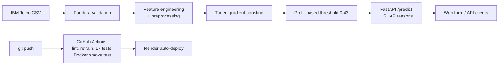

# Customer Churn Prediction

[](https://github.com/mhamad1213/churn-prediction/actions/workflows/ci.yml)


Predicting which telecom customers are about to leave, explaining **why**, and deciding **who is worth contacting**, served as a live web app and API.

### 🔗 Live demo: https://churn-prediction-hbcb.onrender.com
*Hosted on Render's free tier: the first visit after a quiet spell takes up to a minute to wake up. API docs at [`/docs`](https://churn-prediction-hbcb.onrender.com/docs).*


## Highlights
- **Recall on churners up from 56% to 80%** on held-out data by handling class imbalance and tuning gradient boosting (PR-AUC 0.634 → 0.667).
- **Decision threshold set by profit, not the 0.5 default:** £15,060 simulated campaign profit, **+21%** vs the baseline model and **2.7×** contacting everyone.
- **Every prediction is explained** with its top 3 risk drivers (SHAP).
- **Production pipeline:** Pandera + Pydantic validation, 17 pytest tests, GitHub Actions retrains the model from scratch on every push, Docker image smoke-tested in CI, auto-deployed to Render.

## Problem
A subscription business loses revenue every time a customer cancels. If we can rank customers by churn risk, a retention team can contact the riskiest ones first. Success is measured by **churners caught and profit**, not raw accuracy: on this data, predicting "nobody churns" is already 73.5% accurate.

## Data
[IBM Telco Customer Churn](https://github.com/IBM/telco-customer-churn-on-icp4d): 7,043 customers, 19 features (contract, services, billing, tenure), 26.5% churn. Cleaned and validated with a Pandera schema (`src/churn/data.py`). Exploration in `notebooks/01_eda.ipynb`.

## Results (held-out test set, 1,409 customers)

| Model | ROC-AUC | PR-AUC | Recall (churners) | Precision |
|---|---|---|---|---|
| Logistic regression baseline | 0.842 | 0.634 | 0.559 | 0.657 |
| **Tuned gradient boosting, class-balanced** | **0.846** | **0.667** | **0.799** | 0.507 |

**Model comparison (5-fold cross-validation on the training set):**

| Model | ROC-AUC | PR-AUC |
|---|---|---|
| Logistic regression (balanced) | 0.846 | 0.660 |
| Random Forest | 0.844 | 0.655 |
| **Gradient boosting (tuned, balanced)** | **0.849** | **0.661** |
| PyTorch neural network (MLP) | 0.843 | 0.647 |

All models land close together, which is typical for tabular data of this size. The biggest gain came from **handling class imbalance**, not from model choice. Gradient boosting was kept as it scored best on PR-AUC and is fast and explainable.

### Choosing who to contact
Assumptions: a retention offer costs **£20**, a saved customer is worth **£300**, and offers work **30%** of the time. Expected profit was computed at every threshold on cross-validated predictions; **0.43** maximised it.


| Strategy (test set) | Simulated profit |
|---|---|
| Contact everyone | £5,480 |
| Baseline model, 0.5 threshold | £12,450 |
| **Tuned model, 0.43 threshold** | **£15,060** |

## How it works



- **One scikit-learn pipeline** (feature engineering → scaling/one-hot → model) is used for training *and* serving, so there is no train/serve mismatch and no data leakage in cross-validation.
- **`POST /predict`** takes a customer's details and returns the churn probability, risk level, whether to contact them, and the top 3 reasons. Input is validated twice: Pydantic (types and ranges) then Pandera (same schema as training).
- **Docker:** the image downloads the data and trains the model during the build, so the model is always saved and loaded with the same library versions. Slim runtime dependencies (no torch/jupyter), non-root user, about 140 MB of RAM in use.

## Project structure
```
├── .github/workflows/ci.yml   # lint, retrain from scratch, test, build + smoke-test Docker image
├── Dockerfile                 # production image: trains the model at build time, serves the API
├── requirements.txt           # full dev environment
├── requirements-deploy.txt    # slim runtime dependencies (no torch/jupyter)
├── data/raw/                  # downloaded CSV (git-ignored)
├── docs/                      # screenshot
├── models/                    # threshold.json (model file is rebuilt by training)
├── notebooks/                 # EDA and feature exploration
├── reports/                   # metrics JSON + figures
├── scripts/download_data.py
├── src/churn/
│   ├── data.py                # load, clean, Pandera schemas
│   ├── features.py            # feature engineering + preprocessing
│   ├── evaluate.py            # metrics incl. top-20% lift
│   ├── train_baseline.py      # logistic regression baseline
│   ├── train_models.py        # RF / gradient boosting comparison
│   ├── tune.py                # class imbalance + hyperparameter tuning
│   ├── threshold.py           # profit-based decision threshold
│   ├── neural_net.py          # PyTorch MLP as a scikit-learn estimator
│   ├── explain.py             # SHAP reasons per prediction
│   ├── api.py                 # FastAPI service
│   └── static/index.html      # web form
└── tests/                     # 17 pytest tests
```

## Run it locally
```bash
python -m venv .venv && source .venv/bin/activate
pip install -r requirements.txt
python scripts/download_data.py
export PYTHONPATH=src
python -m churn.train_baseline && python -m churn.tune && python -m churn.threshold
python -m pytest
uvicorn churn.api:app --reload --app-dir src     # then open http://127.0.0.1:8000
```

### Or with Docker
```bash
docker build -t churn-api .
docker run -p 8000:8000 churn-api                  # then open http://127.0.0.1:8000
```

## Limitations and next steps
- **One public dataset:** a real deployment would retrain on the company's own customers and monitor for drift as behaviour changes.
- **Profit assumptions are estimates:** an A/B test of the retention offer would replace £20 / £300 / 30% with measured values.
- **Batch scoring:** a nightly job scoring the whole customer base into a database would suit a real retention team better than one-at-a-time requests.
- **Free hosting** sleeps when idle; a paid instance would remove the cold start.

## Tech
Python · pandas · scikit-learn · PyTorch · SHAP · Pandera · FastAPI · Pydantic · pytest · ruff · GitHub Actions · Docker · Render
